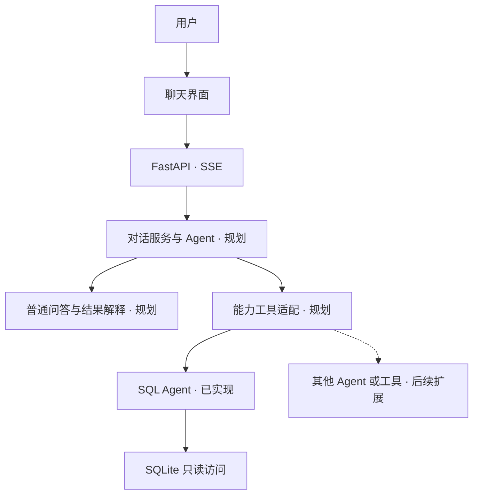

<div align="center">

# ChatBI

**以对话连接数据，让分析过程与结论都有依据。**

本地对话式分析助手：一边问数据库，一边问文档。基于 OpenAI Agents SDK / LangChain 构建，
按模块扩展 Agent 能力。


[项目架构](#项目架构) · [快速开始](#快速开始) · [文档问答](#多模态文档问答) ·
[API](#api-接口) · [开发路线](#开发路线) ·
[项目设计](docs/chatbi-project-design.md) · [RAG 设计](docs/multimodal-rag-design.md)

</div>

---

## 项目简介

ChatBI 希望用户在一个窗口里完成两件事：

1. **问数据**：把自然语言转成受控的只读 SQL，展示执行过程、结果表与解释，支持连续追问。
2. **问文档**：上传一个或多个 PDF，后台解析成带页码与图片的块，回答时给出来源页码，必要时直接把原图贴出来。

两者共用同一套本地部署：接口、索引、问答都在本机；只有 PDF 解析这一步交给带 GPU 的远程实例，
因为 MinerU 的版面/公式/表格识别是唯一真正吃显卡的环节。

当前状态：

| 能力 | 状态 |
| :--- | :--- |
| SQL 数据问答（Agents + LangChain 双运行时） | 已完成 |
| 文档问答（上传 → 解析 → 切块 → 向量 → 图文回答） | 已完成，端到端跑通 |
| Streamlit 测试页 | 已完成 |
| React 前端（数据问答 + 文档问答两个入口） | 已完成，位于 `E:\project\Framework` |
| 统一对话入口（一个会话里混两种问法） | 已评估，暂不做（见 [设计取舍](#设计取舍)） |

## 项目架构

### 数据问答



| 层次 | 职责 | 当前状态 |
| :--- | :--- | :--- |
| 对话与编排 | 理解任务、选择能力、整合证据并生成最终回复 | 已设计，待开发 |
| 能力模块 | SQL Agent 负责数据库查询，文档 RAG 负责知识库问答 | 均已实现 |
| 服务与协议 | FastAPI 接口、Pydantic 数据契约、SSE 事件流 | 已实现 |
| 前端交互 | 消息、阶段进度、SQL 卡片、结果表、引用与图片 | Streamlit + React |
| 上下文 | 当前会话问答与近期查询证据 | 问答文本历史已有，结构化结果上下文待开发 |

### 多模态文档问答

```
                本机                                      GPU 实例
┌───────────────────────────────┐          ┌──────────────────────────────┐
│ 前端 ──► FastAPI(8791)        │  Kafka   │  worker                      │
│           │ 投 doc.parse.request├─────────►│   ① 消费 + Redis 幂等锁      │
│           ▼                   │          │   ② mineru parse -p all      │
│        SQLite rag.db          │          │   ③ 产物留在实例磁盘          │
│        data/mmrag/docs/…      │◄─────────┤   ④ 发 status / result       │
│   bridge（本机常驻）           │  scp 拉回 │                              │
│     切块 → bge-m3 → vectors.npy│          └──────────────────────────────┘
│     补图 → 写库 → 推 SSE       │
└───────────────────────────────┘
```

完整架构图：[docs/images/mmrag-architecture-v2.png](docs/images/mmrag-architecture-v2.png) ·
状态机：[docs/images/mmrag-doc-state.png](docs/images/mmrag-doc-state.png)

**为什么实例只做解析**：`/workspace` 是容器根 overlay，实例释放即丢；文档元数据、向量、
会话历史必须落在本机。实例按小时计费，只有解析那几分钟真正需要 4090。

| 组件 | 位置 | 作用 |
| :--- | :--- | :--- |
| Kafka（3 topic） | 实例 | `doc.parse.request` / `doc.parse.result` / `doc.parse.dlq`，key=doc_id 保序 |
| Redis | 实例 | 幂等锁 `parse:lock:{doc_id}:{attempt}`、SSE 状态广播 `mmrag:status` |
| MinerU 4.2.1 | 实例 | PDF → markdown + 图片块定位符，tier=standard，GPU 加速 |
| bridge | 本机 | 消费 result、scp 拉产物、切块、向量化、补图、写库、推 SSE |
| bge-m3（1024 维） | 本机 CPU | 块与问题的向量化，L2 归一化后点积即余弦 |
| SQLite + vectors.npy | 本机 | 文档/块/消息三张表 + 全量向量矩阵 |

**文档状态机**：

```
pending（待解析）──投递──► parsing（解析中）──切块入库──► done（解析完成）
                              └──── 异常/超时/DLQ ────► failed（可重投）
```

`done` 在本机把产物拉回、切块、向量化、补图**全部完成之后**才置位——否则前端看到「完成」
就问，检索结果还是空的。看门狗每 5 秒扫一次，`parsing` 超过 30 分钟自动判 `failed`。

**图文混排**：MinerU 的 markdown 里图片是块定位符（`doc:xxxx/page:3/block:1`），不是文件。
bridge 会用 `mineru read <locator> -f image` 把图导成 PNG 拉回本机，改写路径后再入库；
回答时只返回图片 URL（不返回 base64），前端按 `blocks` 渲染。

## 快速开始

需要 **Python 3.12**、**[uv](https://docs.astral.sh/uv/)**。命令都在项目根目录执行。

### 1. 安装依赖

```shell
uv sync                      # 数据问答 + 文档问答骨架
uv sync --extra embed        # 另装 sentence-transformers（约 2.5GB，用于 bge-m3）
```

不装 `embed` 也能跑：向量化会退到 hash 实现，链路能通，但没有语义检索能力（仅供联调）。

### 2. 配置

复制 `.env.example` 为 `.env`：

```dotenv
# 模型（数据问答 + 文档问答共用）
OPENAI_API_KEY=your-api-key
OPENAI_BASE_URL=https://api.deepseek.com
OPENAI_MODEL=deepseek-v4-pro
OPENAI_REASONING_EFFORT=none
OPENAI_VISION_MODEL=deepseek-flash

# 文档问答依赖的中间件（走 SSH 隧道时都填 127.0.0.1）
REDIS_HOST=127.0.0.1
REDIS_PORT=6379
REDIS_PASSWORD=

KAFKA_BOOTSTRAP_SERVERS=127.0.0.1:9092

# 解析所在的 GPU 实例（ssh 别名写在 ~/.ssh/config）
MMRAG_SSH_HOST=mmrag
MMRAG_MINERU_TIER=standard
MMRAG_MINERU_PAGES=all
MMRAG_API_BASE=http://127.0.0.1:8791

# 向量化：模型缓存放本机，装好之后直接离线
MMRAG_EMBED_CACHE=E:\project\chatbi\data\hf-cache\hub
MMRAG_EMBED_OFFLINE=1
MMRAG_EMBED_ENDPOINT=https://hf-mirror.com
```

`.env` 不纳入 Git（`.gitignore` 里有 `.env` 与 `.env.*`），只有 `.env.example` 入库。
模型端点需要支持 Responses API 和结构化输出；`OPENAI_REASONING_EFFORT=none` 在支持的模型上关闭思考。

### 3A. 启动数据问答（本机，最小路径）

```shell
# 准备 Chinook 示例库：data/chinook.db（不随仓库提交，只读访问，缺失不会自动创建）

uv run uvicorn chatbi.api.app:create_app --factory --host 127.0.0.1 --port 8000
```

打开 [API 文档](http://127.0.0.1:8000/docs)，试一句「统计 artists 表中的艺术家总数」。

Streamlit 测试页（另开终端）：

```shell
uv run streamlit run src/chatbi/frontend/app.py --server.address 127.0.0.1 --server.port 8501
```

### 3B. 启动文档问答

这条链路需要一台带 GPU 的实例跑 MinerU。分两段配。

**① 实例侧**（Redis、Kafka、MinerU、worker 都装在 `/workspace/software` 下）

```bash
# Redis
redis-server /workspace/software/redis/redis.conf

# Kafka（KRaft 单节点；advertised.listeners 必须是客户端可达地址）
/workspace/software/kafka/bin/kafka-server-start.sh -daemon /workspace/software/kafka/server.properties

# MinerU 本地解析服务
/workspace/software/mineru-venv/bin/mineru server start

# 代码与依赖
scp -rq src/chatbi <host>:/workspace/software/mmrag/src/
/workspace/software/mineru-venv/bin/pip install -q kafka-python==3.0.13 redis python-dotenv

# worker（消费 Kafka，调 MinerU，回写结果）
bash /workspace/software/mmrag/run-worker.sh start
```

**② 本机侧**（隧道 + bridge + API）

```shell
# 平台只映射 SSH 一个端口，6379/9092 全靠隧道
ssh -N -L 6379:127.0.0.1:6379 -L 9092:127.0.0.1:9092 <host>

uv run python -m chatbi.mmrag.bridge        # 常驻：接 result、拉产物、切块、向量化
uv run uvicorn chatbi.mmrag.api.app:create_app --factory --host 127.0.0.1 --port 8791
```

浏览器打开 `http://127.0.0.1:8791/mmrag`，就能上传 PDF 并提问（内置单文件页面）。

**③ React 前端**（`E:\project\Framework`，两个入口：数据问答 / 文档问答）

```shell
cd E:\project\Framework
npm install
npm run dev -- --host 127.0.0.1     # http://127.0.0.1:5173
```

Vite 按前缀分流：`/api/mmrag` 与 `/static` → 8791，其余 `/api` → 8000。
**顺序不能反**，否则 `/api/mmrag/*` 会被 `/api` 的规则抢走。

## 模型运行时：OpenAI Agents 与 LangChain

SQL Agent 保留两套后端：OpenAI Agents 使用原有工作流；LangChain 使用原生 Agent 与 LangGraph 编排。

| 运行时 | 包 | 模型调用 |
| :--- | :--- | :--- |
| OpenAI Agents SDK | `chatbi.sql_agent` | Responses API + 结构化输出（默认） |
| LangChain | `chatbi.sql_agent_langchain` | Chat Completions + function calling |

两者共享 SQL 契约、只读数据库与安全校验。LangChain 独立编排多 Agent，并支持隐私审批暂停与恢复：

```python
from chatbi.api.app import create_app
from chatbi.sql_agent_langchain import open_sql_agent_langchain

app = create_app(service_factory=open_sql_agent_langchain)
```

适合不支持 Responses API、但兼容 Chat Completions 的端点（如 DeepSeek）。审批接口见
[LangChain 接口与使用说明](docs/langchain-sql-agent-workflow.md)。

## 楼道隐患识别

Streamlit 侧边栏的「🔥 楼道风险识别」入口：上传图片 → DeepSeek 视觉模型 → 五档分级
（🔴 高风险 / ⚠️ 中风险 / ℹ️ 低风险 / ✅ 无风险 / ⚪ 非楼道）。

通过 `POST /api/v1/fire-risk` 暴露，视觉模型 id 由 `OPENAI_VISION_MODEL` 指定（缺省
`deepseek-flash`）。未配置或调用失败返回 503/502，不影响其他接口。识别用 function calling
强制结构化输出，并关闭思考模式——DeepSeek 思考模式不支持强制 `tool_choice`。

## API 接口

### 数据问答（默认 8000）

| 方法 | 路径 | 用途 |
| :--- | :--- | :--- |
| `POST` | `/api/v1/chat/stream` | 聊天 SSE 事件流，供前端展示过程与回答 |
| `POST` | `/api/v1/query` | 一次性返回 SQL、结果和回答 |
| `POST` | `/api/v1/fire-risk` | 上传楼道图片，返回火灾隐患分级 |
| `GET` | `/api/v1/chat/events/schema` | 获取完整事件 JSON Schema |
| `GET` | `/health` | 检查应用是否已完成启动 |
| `GET` | `/docs` | Swagger 交互式文档 |

事件按 `payload.type` 路由，`answer.delta` 追加临时正文、`answer.completed` 替换、收到
`run.completed` 才算正常结束。完整格式与示例见 [SSE 交互协议](docs/chat-stream-protocol.md)。

### 文档问答（默认 8791）

| 方法 | 路径 | 用途 |
| :--- | :--- | :--- |
| `POST` | `/api/mmrag/docs/upload` | 多文件上传（multipart `files[]`），立刻返回 `pending` |
| `GET` | `/api/mmrag/docs` | 文档列表（带状态、页数、失败原因） |
| `GET` | `/api/mmrag/docs/status?ids=a,b` | 批量补状态（刷新/断线重连用） |
| `GET` | `/api/mmrag/docs/events` | 全局 SSE，推 `pending → parsing → done/failed` |
| `GET` | `/api/mmrag/docs/{doc_id}` | 单文档详情 |
| `POST` | `/api/mmrag/docs/{doc_id}/reparse` | 重新投递（`attempt + 1`，解析中返回 409） |
| `POST` | `/api/mmrag/chat/stream` | 图文问答 SSE，multipart：`question` / `session_id` / `files[]` / `image` |
| `GET` | `/api/mmrag/sessions` | 会话列表（标题取首条提问） |
| `GET` | `/api/mmrag/sessions/{sid}/messages` | 会话历史（assistant 带 `blocks`，刷新不丢图） |
| `GET` | `/mmrag` | 内置单文件页面（不进 openapi） |

**问答事件流**（`POST /api/mmrag/chat/stream`，`text/event-stream`）：

| 事件 | 内容 |
| :--- | :--- |
| `start` | `{session_id}`，流已建立，检索要十几秒，先别白屏 |
| `attached` | `{docs:[{doc_id, filename, status, pages, error}]}` |
| `waiting` | `{pending, total, waited, docs}`，每 2 秒一次，最长等 240 秒 |
| `meta` | `{session_id, citations, hits, failed_docs}` |
| `delta` | `{text}`，正文增量 |
| `done` | `{message_id, blocks}`，`blocks` 含 `text` / `image` |
| `error` | `{message}` |

```bash
curl -N -X POST http://127.0.0.1:8791/api/mmrag/chat/stream \
  -F "question=这份文档讲什么" -F "files=@test.pdf"
```

回答正文里的 `[来源 2 · 第 3 页]` 由前端渲染成角标；图片只给
`/static/docs/{doc_id}/parsed/images/*.png` 这样的 URL。

## 前端

| 入口 | 位置 | 说明 |
| :--- | :--- | :--- |
| Streamlit | `src/chatbi/frontend/app.py` | 数据问答 + 楼道风险识别，SSE 消费，会话保留最近 10 轮 |
| React | `E:\project\Framework` | 左侧菜单两入口：SQL Agent / 文档问答；对话问答页有多文件附件、解析进度、引用与图片 |
| 内置页 | `src/chatbi/mmrag/web/index.html` | 单文件、无构建，`GET /mmrag` 直接可用，方便验证链路 |

React 客户端的文档问答支持一次挂多个 PDF 再一起发送：附件 → `attached` → `waiting`（显示
`1/2 已解析`）→ `meta` → 流式正文 → `done`。历史会话在左栏，点击即切换；会话 id 存
`localStorage`。

## 开发与验证

```shell
uv run pytest -q                 # 离线测试，不调用真实模型
uv run ruff check src tests scripts
uv run ruff format src tests
uv lock --check

cd E:\project\Framework
npm test                         # 前端单元测试（jsdom + Testing Library）
npm run build
```

最近一次全量结果：**292 passed**（`tests/`）；`ruff check` 全绿。前端 `26 tests` 通过。

<details>
<summary><strong>文档问答的端到端脚本</strong></summary>

| 脚本 | 验证什么 |
| :--- | :--- |
| `scripts/mmrag_plumbing_smoke.py` | 不依赖 worker：本机推文件 → 实例跑 MinerU → 投递/消费 → 切块入库 |
| `scripts/mmrag_live_e2e.py` | 真 worker：投 `ParseRequest`，轮询到 `done`，打印块数与向量数 |
| `scripts/mmrag_http_e2e.py` | 真 HTTP：上传 → 状态轮询 → `chat/stream` 全流程 |
| `scripts/mmrag_multifile_e2e.py` | 一次提交 2 份 PDF + 一句提问 |
| `scripts/mmrag_fix_figures.py` | 给历史文档补图（块定位符 → PNG） |
| `scripts/mmrag_chat_history.py` | 查看/导出会话历史（`--md` 导出带图 markdown） |
| `scripts/redis_smoke.py` / `kafka_smoke.py` | 中间件连通性 |

```shell
uv run python scripts/mmrag_live_e2e.py --pdf tmp/test.pdf --timeout 300
```

</details>

### 提交前扫描机密

仓库带一个 pre-commit 钩子，扫暂存区里形如 `sk-…`、`AKIA…`、`ghp_…`、私钥、带密码的 DSN
的内容。首次 clone 后启用一次：

```shell
git config core.hooksPath .githooks
python scripts/check_secrets.py            # 手动全量扫
python scripts/check_secrets.py --staged   # 只看暂存区
```

`.githooks/*` 在 `.gitattributes` 里固定为 LF，否则 Windows 检出后 shell 会 `bad interpreter`。

## 项目结构

```text
chatbi/
├── src/chatbi/
│   ├── api/                 # FastAPI 路由与 SSE 传输
│   ├── frontend/            # Streamlit 聊天测试页与 SSE 客户端
│   ├── sql_agent/           # 数据查询能力模块（Agents 运行时）
│   │   ├── agents/          # 模型运行时与生成、修复阶段
│   │   ├── database/        # SQLite 适配、SQL 校验和执行
│   │   ├── workflow.py      # 固定流程与修复编排
│   │   ├── service.py       # Python 服务入口
│   │   ├── events.py        # Pydantic 事件契约
│   │   ├── streaming.py     # 事件通道与展示投影
│   │   ├── redaction.py     # 可替换的脱敏策略
│   │   └── summary.py       # 结果汇总策略
│   ├── sql_agent_langchain/ # 原生多 Agent、LangGraph 与隐私审批暂停/恢复
│   ├── fire_risk/           # 楼道隐患识别（视觉模型分级）
│   ├── mmrag/               # 多模态 RAG
│   │   ├── api/             # docs / chat / sessions / SSE / 上传 / 内置页面
│   │   ├── worker/          # 部署在 GPU 实例：消费、调 MinerU、回写、解析台账
│   │   ├── bridge/          # 本机：接结果、scp 拉产物、切块补图、看门狗
│   │   ├── ingest/          # 切块、bge-m3 向量化、写向量库
│   │   ├── rag/             # 检索、提示词、模型调用、回答块
│   │   ├── web/index.html   # 内置单文件页面
│   │   ├── db.py            # SQLite（documents / chunks / messages）
│   │   └── storage.py       # 落盘与静态 URL
│   └── settings.py          # 模型配置加载
├── scripts/                 # 架构图、冒烟、端到端、历史修复、机密扫描
├── tests/                   # 离线测试
├── docs/                    # 设计、协议与开发记录
├── data/                    # 本地数据库与解析产物，不纳入 Git
├── .githooks/pre-commit
├── .env.example
├── pyproject.toml
└── uv.lock
```

## 项目文档

| 文档 | 内容 |
| :--- | :--- |
| [项目设计](docs/chatbi-project-design.md) | 产品定位、MVP 范围、对话与 SQL 能力分层、交付阶段 |
| [功能设计](docs/chatbi-functional-design.md) | 对话、查询、追问、结果解释、多次分析与验收规则 |
| [SQL Agent 技术设计](docs/sql-agent-technical-design.md) | 查询模块的架构、职责与安全边界 |
| [SQL Agent 开发记录](docs/sql-agent-development-plan.md) | 查询模块的分阶段实现和验收结果 |
| [SSE 交互协议](docs/chat-stream-protocol.md) | 前后端事件、组件映射与接入示例 |
| [多模态 RAG 设计](docs/multimodal-rag-design.md) | 分层职责、状态机、Kafka topic、DDL、问答链路 |
| [RAG 项目结构](docs/mmrag-structure.md) | 目录树、数据流、设计理由与「还没做的」清单 |
| [事件 JSON Schema](docs/chat-stream-event.schema.json) | Pydantic 生成的协议快照 |

## 设计取舍

**为什么文档解析用 Kafka 而不是 `BackgroundTasks`**：MinerU 单篇几十秒到几分钟，进程重启
任务就丢了；还需要重放、DLQ 和按 doc 扩容。Kafka 让「加一台 worker」不用改代码。

**为什么向量化放本机**：切块依赖本机产物（页码、bbox、图片路径），把 embedder 挪到实例
就得同时搬切块、改回传格式，还要在实例重下模型（`/workspace` 不持久）。

**为什么 SQL 与文档问答不合并成一个会话**：两者历史语义不同（SQL 无落库、文档有
`session_id`）、流协议不同（一种有序号校验，一种没有）、附件只属于文档模式。硬合会让每条
消息都带「我属于哪种模式」的判断，收益不抵成本。评估记录见
[设计说明](docs/mmrag-structure.md)。

## 开发路线

| 阶段 | 内容 | 状态 |
| :--- | :--- | :--- |
| 数据查询基础 | 独立 SQL Agent、只读执行、校验修复与汇总 | 已完成 |
| 服务与交互基础 | FastAPI、SSE、Streamlit 页面、当前会话问答上下文 | 已完成 |
| 文档问答 | 上传 → Kafka → MinerU → 回传 → 切块 → 向量 → 图文回答 | 已完成 |
| React 前端 | 两个入口、历史会话、多文件一次发送、解析进度 | 已完成 |
| 统一对话入口 | SQL 工具适配、普通问答路由、统一运行预算与事件聚合 | 暂缓 |
| 连续分析 | 结构化结果上下文、追问解释、受限多次查询与对比 | 已规划 |
| 检索增强 | 换 FAISS/hnswlib、图片向量化、rerank、文档去重（SHA-256） | 按需 |
| MVP 业务验收 | 人工审核问题集、独立参考 SQL、路由与多轮评估 | 待建设 |

## 当前边界

- **本地单用户**：默认绑定 `127.0.0.1`，无认证、无多用户隔离、无后台任务队列。
- **只读 SQLite**：不支持写入、建表或执行模型生成的任意代码。
- **展示脱敏**：SSE 隐藏 SQL 字面量与参数；`/api/v1/query` 返回原始数据。
- **会话不落库（SQL 侧）**：问答历史在前端内存，`history` 随请求传递，断线不重放。
  文档侧会话落 `rag.db` 的 `messages` 表，刷新可恢复。
- **向量是全量矩阵**：`vectors.npy` + 内存点积，几千块以后要换 FAISS/hnswlib。
- **图片不做向量**：靠「命中同页文本」带出，PPT 类纯图文档会退化。
- **单 SQLite 连接**：并发上传会排队；文档列表上限 200 条、无分页。
- **实例不持久**：`/workspace` 随实例释放消失，解析产物必须及时拉回本机。
- **模型数据范围**：问题与获准的 schema 会发到所配置的模型端点；汇总阶段发送预算内的结果。

第一版面向本地个人使用，以查询、追问、结果解释和文档问答为主；
完整阶段与验收规则见 [项目设计](docs/chatbi-project-design.md) 与 [功能设计](docs/chatbi-functional-design.md)。
