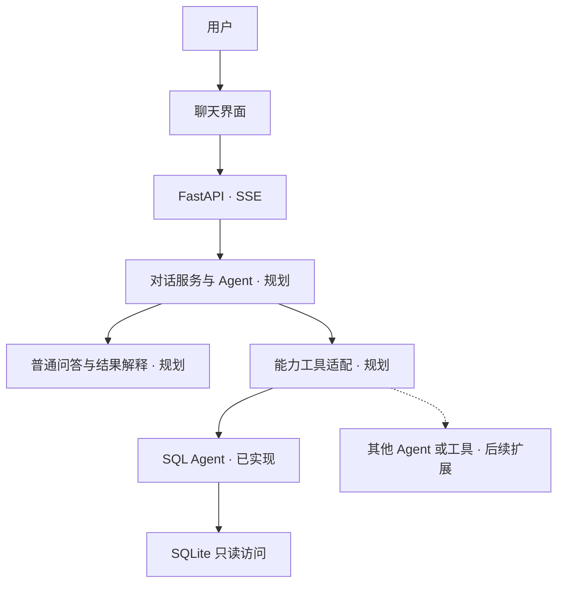

<div align="center">

# ChatBI

**以对话连接数据，让分析过程与结论都有依据。**

以数据分析为核心的本地对话助手，基于 OpenAI Agents SDK 构建，按模块扩展 Agent 能力。


[项目架构](#项目架构) · [快速开始](#快速开始) · [开发路线](#开发路线) · [项目设计](docs/chatbi-project-design.md) · [功能设计](docs/chatbi-functional-design.md)

</div>

---

## 项目简介

ChatBI 希望让用户在一个聊天窗口中完成数据查询、连续追问、结果解释与对比分析，
同时处理普通交流和一般知识问题。涉及数据库的结论以真实查询结果为依据。

**SQL Agent 是其中的数据查询模块**：它将自然语言转换为受控的只读查询，
也可通过独立的 Python 服务与 HTTP 接口供其他 Agent 或应用复用。
对话入口、上下文管理、能力编排和前端交互共同构成 ChatBI。

当前已完成 SQL 查询模块、FastAPI 服务和 Streamlit 测试页；
页面请求仍直接进入 SQL 工作流。上层对话 Agent、普通问答路由与受限多次查询分析
已完成设计，尚未接入。下面的快速开始用于体验当前已有能力。

## 项目架构

目标架构如下，标注“规划”的部分尚未实现：



| 层次 | 职责 | 当前状态 |
| :--- | :--- | :--- |
| 对话与编排 | 理解任务、选择能力、整合证据并生成最终回复 | 已设计，待开发 |
| 能力模块 | SQL Agent 负责数据库查询，其他能力按需接入 | SQL 模块已实现，工具适配待开发 |
| 服务与协议 | FastAPI 接口、Pydantic 数据契约、SSE 事件流 | 已实现，后续扩展父子调用关联 |
| 前端交互 | 聊天消息、阶段进度、SQL 卡片、结果表与正文 | 已有 Streamlit 测试页 |
| 上下文 | 当前会话问答与近期查询证据 | 已有问答文本历史，结构化结果上下文待开发 |

### 已有能力：SQL Agent

| 能力 | 说明 |
| :--- | :--- |
| 自然语言查询 | 理解问题、选择数据表，基于真实 schema 生成 SQL |
| 受控执行 | SQL AST 校验、SQLite 只读连接、表与字段访问限制 |
| 有限次修复 | 根据校验或执行反馈调整 SQL，重新校验后执行 |
| 过程可见 | 展示阶段进度、脱敏 SQL 和每次查询的结果 |
| 流式回答 | SSE 输出回答片段；汇总失败时保留结果并降级 |

模块内部由 Python 显式编排：**理解与选表 → SQL 生成 → 校验 → 只读执行 → 结果汇总**。
需要补充条件时返回澄清问题；错误修复受次数和时间预算限制。
数据库执行由传统 Python 代码负责，不运行模型生成的任意 Python 程序。

## 快速开始

需要 **Python 3.12** 和 **[uv](https://docs.astral.sh/uv/)**。以下命令在项目根目录执行。

### 1. 安装依赖

```shell
uv sync
```

### 2. 配置模型

复制 `.env.example` 为 `.env`，填写模型服务配置：

```dotenv
OPENAI_API_KEY=your-api-key
OPENAI_BASE_URL=https://api.openai.com/v1
OPENAI_MODEL=your-model-name
OPENAI_REASONING_EFFORT=none
```

模型端点需要支持 Responses API 和结构化输出；聊天正文使用流式输出。
配置在应用启动时统一加载，`.env` 不纳入 Git。
`OPENAI_REASONING_EFFORT=none` 在支持该参数的 Responses 模型上关闭思考；
留空则使用模型服务默认值。当前 DeepSeek 官方端点支持此参数，修改后需要重启 FastAPI。

### 3. 准备数据库

将 Chinook 示例数据库放到：

```text
data/chinook.db
```

数据库文件不随仓库提交，需要自行准备。服务以只读方式访问，缺失时不会自动创建。

### 4. 启动服务

```shell
uv run uvicorn chatbi.api.app:create_app --factory --host 127.0.0.1 --port 8000
```

打开 **[交互式 API 文档](http://127.0.0.1:8000/docs)**，即可提交问题：

> 统计 artists 表中的艺术家总数。

### 5. 启动 Streamlit 测试页面

保持 FastAPI 运行，在另一个终端执行：

```shell
uv run streamlit run src/chatbi/frontend/app.py --server.address 127.0.0.1 --server.port 8501
```

打开 **[ChatBI 测试页面](http://127.0.0.1:8501)**，输入问题即可观察阶段进度、
SQL 校验/执行、每次查询的结果表和回答。侧边栏可配置后端地址，或开启事件调试查看
Pydantic 事件数据与运行 ID。

页面通过 HTTP 消费 SSE，不直接连接数据库或加载模型密钥。
同一页面会话保留最近 10 轮问答与查询卡片，后续提问自动携带历史上下文。
修改设置不会清空，点击“新对话”可重置；不写入数据库，浏览器会话重建后不恢复历史。
FastAPI 未启动或连接提前中断时，页面会显示明确错误。
调试模式可查看真实后端响应类型：请求体是 `application/json`，SSE 响应是
`text/event-stream`。Streamlit 在 Python 服务端读取 SSE，浏览器 Network 中的
Streamlit WebSocket 不等同于后端 SSE 请求。

## API 接口

以下是当前已实现的接口。聊天 SSE 目前调用 SQL 模块，后续将接入统一对话服务；
独立查询接口继续作为 SQL 能力入口。

| 方法 | 路径 | 用途 |
| :--- | :--- | :--- |
| `POST` | `/api/v1/chat/stream` | 聊天 SSE 事件流，供前端展示过程与回答 |
| `POST` | `/api/v1/query` | 一次性返回 SQL、结果和回答 |
| `GET` | `/api/v1/chat/events/schema` | 获取完整事件 JSON Schema |
| `GET` | `/health` | 检查应用是否已完成启动 |
| `GET` | `/docs` | Swagger 交互式文档 |

### 聊天事件流

```json
{
  "question": "统计艺术家总数",
  "conversation_id": null
}
```

前端通过 **HTTP POST** 消费 SSE，按 `payload.type` 路由事件，按 `payload.tag` 选择展示组件。
当前 Streamlit 页面使用 Python HTTP 客户端；自建 Web 前端可使用 POST fetch 接入。

| 事件 | 推荐展示 |
| :--- | :--- |
| `run.started` / `run.completed` | 本次请求的开始与结束状态 |
| `progress` | 简短的阶段进度 |
| `sql.started` / `sql.executing` | SQL 卡片与执行状态 |
| `sql.completed` / `sql.failed` | 对应 SQL 的结果表或失败提示 |
| `answer.started` / `answer.delta` / `answer.completed` | 回答正文 |
| `warning` / `run.error` | 告警或错误提示 |

事件带有对话、消息、运行和事件 ID，以及递增序号。
`answer.delta` 追加临时正文，`answer.completed` 用最终正文替换；
收到 `run.completed` 才表示本次正常结束。

完整的数据格式、脱敏规则、取消行为和前端示例见 **[SSE 交互协议](docs/chat-stream-protocol.md)**。

<details>
<summary><strong>PowerShell：调用非流式查询接口</strong></summary>

```powershell
$body = @{ question = '统计 artists 表中的艺术家总数。' } | ConvertTo-Json
$request = @{
    Uri = 'http://127.0.0.1:8000/api/v1/query'
    Method = 'Post'
    ContentType = 'application/json; charset=utf-8'
    Body = [System.Text.Encoding]::UTF8.GetBytes($body)
}
Invoke-RestMethod @request
```

`success`、`needs_clarification`、`failed` 三种业务状态均返回 HTTP 200，调用方需检查 `status`。
请求字段校验失败返回 HTTP 422。结果使用 `columns` 与 `rows` 按位置对应，保留重复列名。

</details>

## 当前边界

- **统一对话入口待开发**：当前聊天面向数据库查询，普通问答、复杂任务编排与跨查询证据整合尚未接入。
- **本地单用户服务**：默认绑定 `127.0.0.1`，暂未提供认证、多用户隔离或后台任务队列。
- **只读 SQLite**：不支持写入、建表或任意代码执行。
- **展示脱敏**：SSE 隐藏 SQL 字面量和参数值。当前 Chinook 应用允许仅来自公开音乐目录表的文本，客户、员工等查询继续隐藏文本；非流式 `/api/v1/query` 返回原始数据。
- **公开阶段进度**：不向前端发送模型内部推理。正文增量脱敏后发送，不再等待换行；未完整的词或潜在敏感内容会暂存，中文通常随标点分片展示，不保证逐字输出。
- **当前对话上下文**：前端在内存保留问答，使用 `history` 随请求传给后端；后端不按 ID 保存会话，也不支持断线重放。
- **模型数据范围**：问题与获准的 schema 会发送到所配置的模型端点；汇总阶段发送预算内的结果数据，SSE 汇总使用脱敏结果。

## 开发与验证

```shell
uv run pytest -q            # 离线测试，不调用真实模型
uv run ruff check src tests # 代码检查
uv run ruff format src tests
uv lock --check             # 检查依赖锁文件
```

当前 **231 项测试通过**，覆盖只读防护、工作流修复、预算与取消、汇总降级、SSE 生命周期、
脱敏、前端 SSE 消费、Streamlit 页面渲染及多轮上下文传递。
真实模型端到端样例已验证 Chinook 艺术家总数为 **275**；该样例不代表整体业务准确率。

<details>
<summary><strong>项目结构</strong></summary>

```text
chatbi/
├── src/chatbi/
│   ├── api/                 # FastAPI 路由与 SSE 传输
│   ├── frontend/            # Streamlit 聊天测试页与 SSE 客户端
│   ├── sql_agent/           # 可独立复用的数据查询能力模块
│   │   ├── agents/          # 模型运行时与生成、修复阶段
│   │   ├── database/        # SQLite 适配、SQL 校验和执行
│   │   ├── workflow.py      # 固定流程与修复编排
│   │   ├── service.py       # Python 服务入口
│   │   ├── events.py        # Pydantic 事件契约
│   │   ├── streaming.py     # 事件通道与展示投影
│   │   ├── redaction.py     # 可替换的脱敏策略
│   │   └── summary.py       # 结果汇总策略
│   └── settings.py          # 模型配置加载
├── tests/                   # 离线测试
├── docs/                    # 设计、协议与开发记录
├── data/                    # 本地数据库，不纳入 Git
├── .env.example
├── pyproject.toml
└── uv.lock
```

</details>

## 项目文档

| 文档 | 内容 |
| :--- | :--- |
| [项目设计](docs/chatbi-project-design.md) | 产品定位、MVP 范围、对话与 SQL 能力分层、交付阶段 |
| [功能设计](docs/chatbi-functional-design.md) | 对话、查询、追问、结果解释、多次分析与验收规则 |
| [SQL Agent 技术设计](docs/sql-agent-technical-design.md) | 查询模块的架构、职责与安全边界 |
| [SQL Agent 开发记录](docs/sql-agent-development-plan.md) | 查询模块的分阶段实现和验收结果 |
| [SSE 交互协议](docs/chat-stream-protocol.md) | 前后端事件、组件映射与接入示例 |
| [事件 JSON Schema](docs/chat-stream-event.schema.json) | Pydantic 生成的协议快照 |

## 开发路线

| 阶段 | 内容 | 状态 |
| :--- | :--- | :--- |
| 数据查询基础 | 独立 SQL Agent、只读执行、校验修复与汇总 | 已完成 |
| 服务与交互基础 | FastAPI、SSE、Streamlit 页面、当前会话问答上下文 | 已完成 |
| 统一对话入口 | SQL 工具适配、普通问答路由、统一运行预算与事件聚合 | 下一阶段 |
| 连续分析 | 结构化结果上下文、追问解释、受限多次查询与对比 | 已规划 |
| MVP 业务验收 | 人工审核问题集、独立参考 SQL、路由与多轮评估 | 待建设 |
| 后续能力 | 图表、导出、会话持久化、联网搜索与更多数据源 | 后续按需扩展 |

第一版面向本地个人使用，以查询、追问和结果解释为主；
完整阶段与验收规则见 [项目设计](docs/chatbi-project-design.md) 和 [功能设计](docs/chatbi-functional-design.md)。
