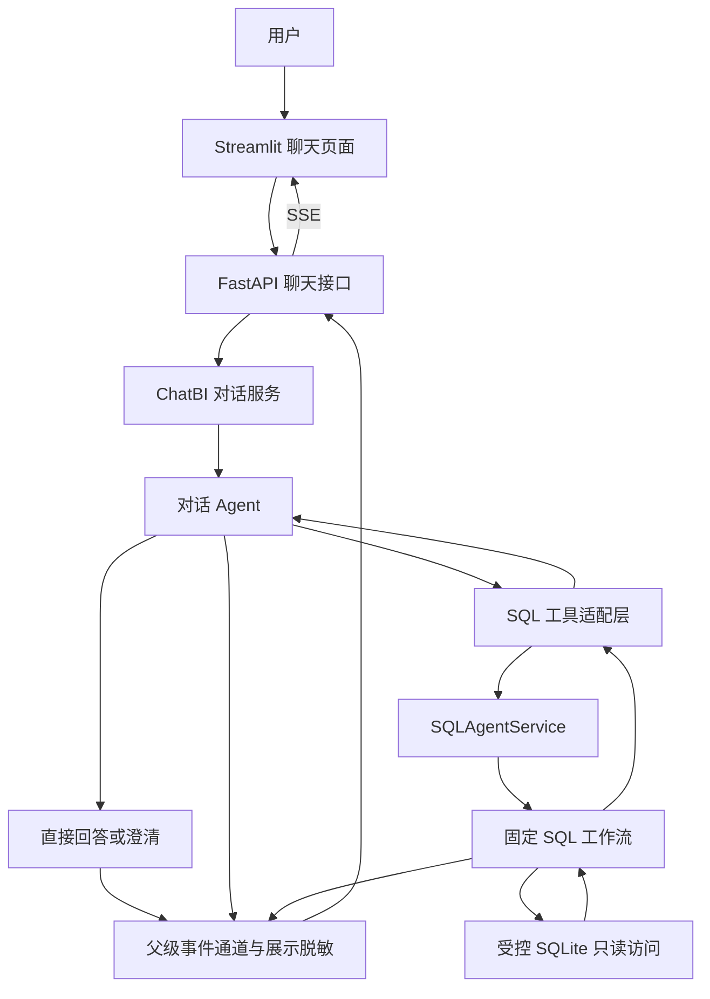

# ChatBI 项目设计文档

版本：v0.1

日期：2026-10-23

状态：根据本轮需求确认形成的 MVP 设计基线；规划能力尚未实现。

## 1. 项目定位

ChatBI 是以数据分析为核心、兼顾普通聊天和知识问答的本地个人助手。
用户通过一个聊天入口查询数据、连续追问、理解结果，也能进行一般交流。
产品以真实数据库查询作为数据结论的依据，并向用户展示查询过程与结果。

SQL Agent 是 ChatBI 内部可独立复用的数据查询能力。其他 Agent 可以通过 Python
服务或 HTTP 接口调用它。ChatBI 对话入口负责理解用户任务、选择能力和组织最终回复，
SQL Agent 负责完成受控的数据库查询工作流。

本文回答“产品做什么、模块如何协作、如何分阶段交付”。具体功能规则与验收见
[功能设计文档](chatbi-functional-design.md)。SQL 内部工作流见
[SQL Agent 技术设计](sql-agent-technical-design.md)，现有事件格式见
[SSE 交互协议](chat-stream-protocol.md)。

## 2. 已确认的产品决策

| 决策 | 本轮确认 |
| --- | --- |
| 核心定位 | 数据分析为主，兼顾普通聊天和一般知识问答 |
| 用户与部署 | 个人、本地使用；先交付 MVP，再考虑团队化 |
| 数据源 | 单个本地 SQLite，默认 `data/chinook.db`，只读 |
| 核心功能 | 自然语言查询、多轮追问、结果解释、过程展示 |
| 复杂问题 | 允许上层 Agent 在次数和时间预算内多次查询、对比分析 |
| 一般知识 | 使用模型已有知识；涉及最新事实时说明无法核实 |
| 联网搜索 | 第一版不接入 |
| 图表与导出 | 后续阶段再做 |
| 会话 | 当前页面会话保留上下文；历史持久化与会话列表后续再做 |
| 实现风格 | Python、集中常量、适度策略模式、构造函数注入、分阶段开发 |

## 3. 成功标准与范围

MVP 应让用户在同一聊天窗口完成以下闭环：提出问题 → 查看查询进度与表格 →
得到基于证据的说明 → 继续追问。普通聊天不应进入 SQL 生成流程。
复杂分析需要展示使用了哪些数据、如何对比，以及哪些结论仍缺少证据。

第一版包含：

- 普通交流、一般知识问答和能力说明。
- 数据查询、统计、筛选、排序、关联、时间对比及受限多次查询。
- 对上轮结果的解释，以及条件变化后的重新查询。
- 问题澄清、空结果、截断、失败和部分结果的明确说明。
- SSE 阶段进度、脱敏 SQL、每次执行的结果表与最终回答。
- 当前会话上下文，以及通过工具适配层复用 SQL Agent。

后续范围包括图表、CSV/Excel 导出、联网搜索、会话持久化、更多数据源、业务语义层。
第一版不提供数据库写入、任意生成代码执行、账号和多租户隔离。

## 4. 当前实现与目标的差异

| 能力 | 当前实际状态 | MVP 目标 |
| --- | --- | --- |
| SQL 工作流 | 已实现理解、选表、生成、校验、执行、修复和汇总 | 复用并保留独立入口 |
| Python 接口 | 已有 `SQLAgentService.ask()` 和 `.stream()` | 新增面向上层 Agent 的工具适配 |
| HTTP 接口 | 已有查询 JSON 接口和聊天 SSE 接口 | 聊天接口接入上层对话服务 |
| 对话路由 | 当前聊天直接进入 SQL 工作流 | 普通问答、结果解释、数据库查询分别处理 |
| 多次业务查询 | 当前单次工作流围绕一个查询目标修复 | 上层可主动分解、对比并多次调用 SQL 能力 |
| 多轮上下文 | Streamlit 内存保存问答文本，随请求传入 | 增加受限的结构化结果上下文 |
| SSE | 已实现流式正文、SQL 卡片、状态和脱敏 | 支持父运行聚合多个子查询 |
| 前端 | 已有 Streamlit 测试聊天页 | 继续用于 MVP 验证 |
| 评估 | 已有离线代码测试；业务评估集待建设 | 增加路由、多轮、多工具与事实忠实度评估 |

SQL 修复次数不等于业务分析的查询次数。一次 SQL 工具调用内部可能因为错误而执行多次，
上层也可能为了回答一个复杂问题主动发起多个独立查询，二者应分别计数。

## 5. 总体架构

模型负责语义理解、能力选择、SQL 生成与结果表达。代码负责权限、预算、校验、
执行、事件关联和资源清理。数据库路径、允许访问的表和执行规则由应用配置决定。

## 6. 模块职责

| 模块 | 职责 | 边界 |
| --- | --- | --- |
| 对话服务（新增） | 管理每轮生命周期、上下文、统一预算、最终回答和事件聚合 | 不直接执行 SQL |
| 对话 Agent（新增） | 普通问答、判断是否查询、补全追问、分解分析任务 | 不绕过工具读取数据库，不将猜测写成查询事实 |
| SQL 工具适配层（新增） | 参数验证、调用 SQL 服务、脱敏结果投影、子事件转发 | 不直接把原始服务响应序列化给上层模型 |
| SQL Agent（已有） | schema、生成、校验、执行、修复、结构化返回 | 保持固定工作流和本地只读权限 |
| 数据库模块（已有） | SQLAlchemy Core、AST 校验、运行时授权、预算和取消 | 不运行任意生成 Python 代码 |
| 展示策略（已有，需扩展） | SQL/结果/正文脱敏、安全增量释放 | 规则按业务配置，不把全部文本默认视为公开 |
| 事件通道（已有，需扩展） | SSE 生命周期、顺序、背压、查询关联 | 子运行不能提前结束父对话 |
| 前端（已有，需扩展） | 聊天、查询卡片、表格、正文、临时上下文 | 不保存模型密钥，不持有数据库连接 |

第一版用一个对话 Agent 加已有 SQL 工作流。不为每一种意图分别建立自主 Agent，
也不同时增加一个独立 LLM 分类器和一个对话模型来重复判断同一问题。
需要替换的能力使用 Protocol 和构造函数注入；普通数据处理保持普通函数或方法。

## 7. SQL Agent 的调用与复用

### 7.1 同进程调用

由应用启动过程创建 SQL 服务，注入工具适配层，再把适配层注册为对话 Agent 的工具。
工具接收完整的自然语言查询及必要上下文，返回结构化业务状态、受限证据和说明。
调用者不需要生成 SQL，也不能传入数据库路径或覆盖安全策略。

这是第一版的推荐接法。现有 `SQLAgentService` 是 Python 服务对象，不直接等同于
SDK 的 `Agent` 实例，因此通过函数工具包装服务接口；不直接对它调用 `Agent.as_tool()`。
具体 SDK 接线在后续技术设计和实现阶段确定。

### 7.2 跨进程调用

独立部署时可通过 HTTP 调用现有 `/api/v1/query`，由调用方适配结果。
当前该 JSON 接口会返回原始 SQL 参数和结果，仅用于本地受信任调用；
不能直接把整份 JSON 当作公开内容或上层模型输入。跨进程调用仍需脱敏投影、
状态处理与超时取消设计。若需要子查询实时进度，还需专门的事件桥接，不能认为 JSON 接口自带流式能力。

### 7.3 工具结果投影（拟新增）

| 信息 | 用途 |
| --- | --- |
| 调用 ID、请求 ID、结果引用 ID | 关联工具调用、查询卡片与最终说明 |
| `success / needs_clarification / failed` | 让上层决定继续分析、澄清或结束 |
| 脱敏列名、受限行数据、返回行数、截断状态 | 提供可核对的证据 |
| 查询范围、必要假设、告警 | 防止把部分数据当作总体 |
| 公开错误码、澄清问题 | 可恢复的交互，不暴露底层私有异常 |

参数及 SQL 字面量继续隐藏。公开 Chinook 音乐目录沿用显式允许策略；
客户、员工等私有来源继续采用保守策略。工具包装不会自动使原始结果变得适合模型或前端展示。

上层对话服务负责用户可见的最终回复。SQL 独立服务保留自身汇总功能；工具模式应支持
复用结构化执行结果、跳过重复的 LLM 总结，或把子总结作为受证据约束的参考。
该模式是拟新增能力，现有 `ask()` 不因此自动变成“只执行不总结”。

## 8. 多轮上下文与证据

当前前端最多展示最近 10 轮，历史请求最多 20 条消息、总计 48000 字符。
后端不会根据 `conversation_id` 自动恢复数据；`session_id` 也不是会话存储。

目标上下文由两部分组成：

1. 问答文本：用于理解省略表达、延续主题和澄清。
2. 受限结果证据：保存近期查询的脱敏表格、条件、结果引用、截断状态与时间，支持解释上轮结果。

第一版仍保存在当前页面会话内，不增加持久化数据库。结果上下文的字段、大小与数量上限
在实现前用 Pydantic 单独定义，并在前后端共同校验；不把完整 SSE 日志全部送给模型。
由于后端不保存可校验快照，客户端回传的历史结果属于非权威历史材料，不能冒充新鲜查询结果。
涉及数值核验、结果缺失、上下文被裁剪或“现在/最新”的问题时，应重新查询。

单独的结果 ID 不能让无状态服务找回结果。未来若增加服务端会话存储，应明确生命周期、
失效和清理规则，再提供按 ID 检索能力。

## 9. SSE 与多次查询的聚合

每个用户消息对应一个父 `run_id`、一个助手 `message_id` 和一条有序 SSE 流。
一次业务查询对应独立的工具调用 ID；其中的 SQL 尝试继续各有独立执行 ID。
拟增加父调用/子运行关联字段，用以区分“第几次分析查询”和“第几次 SQL 修复尝试”。

父对话统一分配事件序号。子 SQL 流的 `run.completed` 表示子查询完成，不得直接当作父运行终止事件转发。
子查询内部的答案事件也不得覆盖父级最终正文：查询过程进入进度/工具卡片，
最终正文由对话服务单独生成。只有父运行完成时，前端才结束本轮输入等待。

沿用 `type` 驱动事件处理、`tag` 选择展示组件，以及 `answer.completed` 最终替换语义。
普通聊天可以完全没有 SQL 事件。扩展字段与事件需先更新 Pydantic、协议版本和兼容规则，
再生成 Schema；本轮不修改现有 v1.0 契约快照。

## 10. 数据边界与运行预算

现有 SQL 默认预算：单条查询 10 秒、SQL 工作流 90 秒、最多执行 3 次、修复 2 次，
返回最多 1000 行、约 2 MiB。模型单次调用当前为 45 秒。
这些预算是单个子工作流的保护，不能替代上层对话总预算。

建议新增以下初始预算，均为待实施配置默认值，后续可根据评估调整：

| 预算 | 建议值 | 执行方式 |
| --- | --- | --- |
| 每轮对话总期限 | 120 秒 | 包含模型、所有工具调用、队列等待和最终汇总 |
| 每轮 SQL 工具调用 | 最多 3 次 | 澄清/失败调用也计入，禁止无限循环 |
| 每轮实际 SQL 执行 | 最多 6 次 | 跨子查询共享；修复执行同样计入 |
| 子工作流期限 | 不超过 90 秒且受父剩余期限约束 | 父取消向下传递；不得每次调用重置总预算 |

次数与总期限由代码强制执行。达到上限后保留已取得的有效证据，说明未完成部分；
证据不足时不能为了生成完整报告继续猜测。客户端断开时取消剩余模型调用与 SQL。

用户可见内容、工具给上层模型的内容以及日志分别做投影。模型仍可能接收原始用户问题与获准 schema，
因此“本地部署”不代表“模型推理或数据全程离线”。密钥从 `.env`/环境变量集中加载，
不进入前端、提示内容、事件或提交记录。

## 11. 技术与工程约定

- Python 3.12、uv、FastAPI、Pydantic、SQLAlchemy Core、SQLite。
- OpenAI Agents SDK，沿用已接入的 Responses 模型运行时。
- Streamlit 继续作为本地 MVP 前端；后端契约保持独立，方便未来替换前端。
- 配置和常量集中定义，模型客户端和数据库资源在应用启动/关闭时统一管理。
- 安全规则由代码强制执行，提示词用于表达职责，不承担唯一的权限防护。
- 逐阶段开发，每阶段有可检查交付物和验收，不一次性实现全部远期能力。

## 12. 交付阶段

| 阶段 | 交付 | 完成条件 |
| --- | --- | --- |
| A：对话契约与工具桥接 | ChatBI 服务契约、SQL 工具投影、预算与父子 ID 设计 | 独立 SQL 接口仍可使用，工具不会泄露原始数据 |
| B：统一对话入口 | 普通问答、单次 SQL 调用、澄清与流式最终回复 | 普通聊天不查库，数据问题基于实际结果回答 |
| C：追问与结果解释 | 临时证据上下文、指代补全、条件变更重查 | “解释这张表”和“那去年呢”走正确路径 |
| D：受限多查询分析 | 顺序多次工具调用、证据对齐、父事件聚合和部分完成说明 | 次数/期限有效，子运行结束不截断父流 |
| E：业务评估与 MVP 验收 | 固定问题集、独立参考 SQL、多轮与协议用例 | 达到功能文档定义的验收门槛 |

未来按需要增加图表/导出、历史会话、外部搜索、业务指标字典和更多数据库适配。
新增 Agent 应对应明确的独立能力，并通过工具或服务接口接入，避免所有模块互相自由调用。

## 13. 质量与主要风险

代码测试通过不能直接证明业务分析准确。应分别评估路由、SQL 结果正确性、上下文理解、
回答忠实度、只读拦截、流式时序、取消和预算。业务测试集需要人工审核问题与独立参考结果。

| 风险 | 应对 |
| --- | --- |
| 将一般知识或猜测当成数据库结论 | 回复说明数据来源，数据库数字必须有查询证据 |
| 多次查询口径不一致 | 保持时间、单位、筛选条件一致；口径不明先澄清 |
| 把相关性说成因果 | 区分观察、贡献分解和待验证解释 |
| 原始工具响应越过脱敏边界 | 专门的工具结果投影，私有数据与异常均不直接透传 |
| 历史文本不足或数据过时 | 显式的临时证据上下文；需要核验时重查 |
| 模型循环调用与延迟叠加 | 父级期限和共享次数预算，预算耗尽返回已有证据 |
| 多个 SQL 子流破坏聊天协议 | 父通道统一关联与排序，仅父运行发最终结束事件 |

实现时仍需确定：新增事件契约的具体字段、历史证据预算与上层提示词。
这些是技术细化项，不改变已经确认的产品范围。未落地前不得在 README 中标注为已支持。
