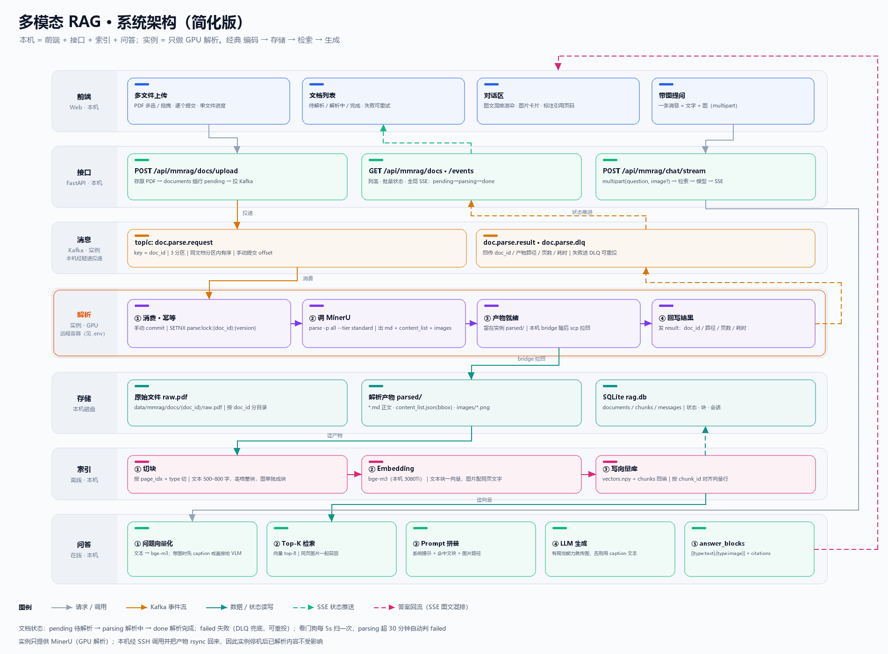
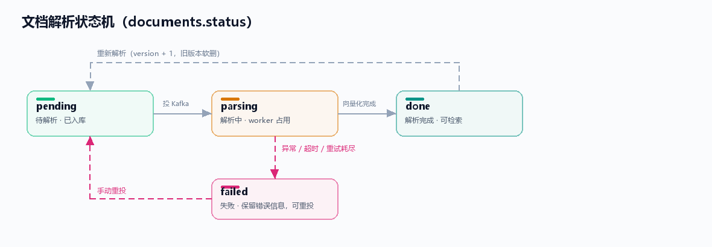
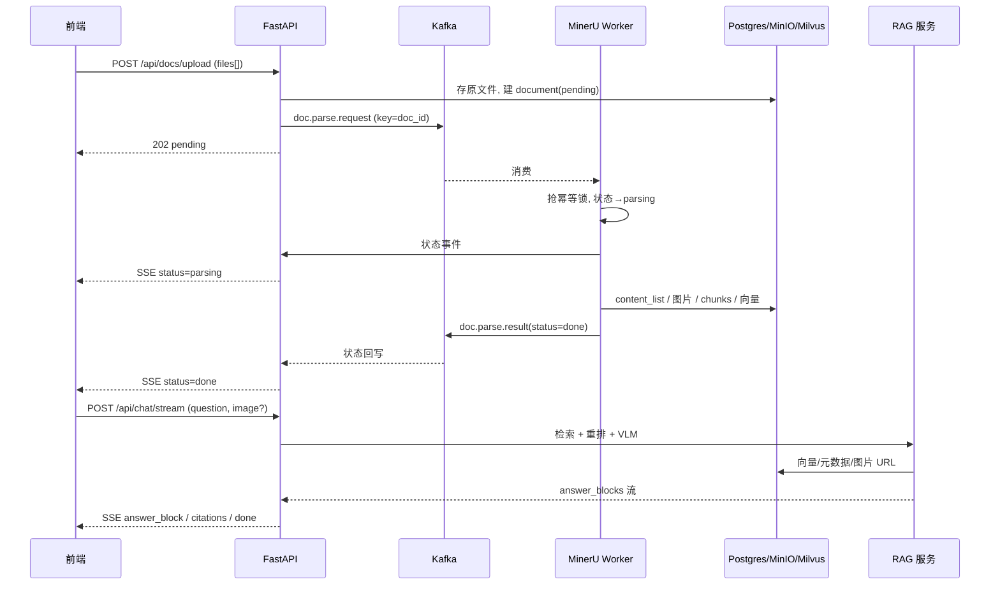

# 多模态 RAG 后端设计

> 目标：前端可批量上传 PDF，后端异步解析（MinerU）建索引；前端实时看到「待解析 / 解析中 / 解析完成」；问答支持图文混排输出与「图片 + 问题」一起提问。
>
> 本文是给开发 agent 的实现规格：组件边界、消息契约、接口、状态机、数据模型、验收点。





> **v2 简化说明（以此为准）**
>
> 当前实现按简化版落地，与下文正文中的「完整版」描述有出入，以下五条覆盖后文：
>
> 1. **存储**不用 MinIO / Postgres / Milvus：原文件与解析产物落本机磁盘 `data/docs/{doc_id}/`，元数据与状态用 SQLite `rag.db`，向量存 `vectors.npy`，按 `chunk_id` 对齐行号。
> 2. **解析在远端实例**：worker 跑在带 GPU 的容器实例上消费 Kafka、调 MinerU，产物 rsync 回本机 `data/docs/{id}/parsed/`，再把 `doc.parse.result` 发回；实例停机不影响已解析内容。
> 3. **不做查询改写、RRF、Rerank**：问答就是「问题向量化 → Top-K → 拼 prompt → LLM」，图片与同页文本块一起召回。
> 4. **图片向量化不做**：图片作为独立 chunk 保存路径与页码，靠同页文本块召回后作为 `image` 块塞进 prompt / answer_blocks。
> 5. **LLM 在本机侧**：走本地或 API 模型；若模型不支持视觉，图片先过 caption 转成文本。

---

## 1. 分层与职责

| 层 | 组件 | 职责 | 关键约束 |
| :--- | :--- | :--- | :--- |
| 前端 Web | 上传页 / 文档列表 / 对话页 | 多选 PDF、展示状态徽标、渲染图文混排、图问提交 | 状态靠 SSE 推送，降级为 2s 轮询 |
| 接入层 | FastAPI | 鉴权、落盘、建任务、投 Kafka、SSE 转发 | 上传接口不做解析，只写 pending 就返回 |
| 消息层 | Kafka | 解析任务解耦、削峰、重试、DLQ | key = `doc_id`，保证单文档有序 |
| 解析 Worker | MinerU + 切块 + Embedding | PDF → 结构化块 → 图片切片 → 向量 | 可水平扩容，同 doc 不并发 |
| 存储 | MinIO / Postgres / Milvus / Redis | 原文件、元数据、向量、任务态 | 图片一律存对象存储，库里只存 URI |
| 问答服务 | RAG | 检索 + 重排 + 多模态拼装 + VLM 生成 | 流式输出，先出文本块再出图片块 |

**为什么解析走 Kafka 而不是直接 BackgroundTasks**：MinerU 单篇可能跑 30s～数分钟，进程重启即丢任务；Kafka 提供持久化、重放、按 key 有序和消费组水平扩容，且失败可进 DLQ 人工重投。

---

## 2. 文档状态机

`documents.status` 四个值，前端徽标一一对应：

| 值 | 前端文案 | 进入条件 |
| :--- | :--- | :--- |
| `pending` | 待解析 | 上传成功、DB 落库、Kafka 投递成功 |
| `parsing` | 解析中 | Worker 消费到消息并抢到幂等锁 |
| `done` | 解析完成 | 切块 + 向量全部写入成功 |
| `failed` | 解析失败（可重试） | 异常 / 超时 / 重试耗尽，错误写入 `error_msg` |

迁移：
- `pending → parsing`：Worker 抢锁成功
- `parsing → done`：`doc.parse.result` 写入
- `parsing → failed`：`doc.parse.result` 带 error，或消费超时看门狗触发
- `failed → pending`：`POST /api/docs/{id}/reparse` 手动重投
- `done → pending`：重新解析，`version + 1`，旧版本 chunk 软删（`is_active = false`）

**幂等**：`SETNX parse:lock:{doc_id}:{version}`，TLL 30min；重复消息直接 ack 丢弃。

---

## 3. 接口契约

```
POST /api/docs/upload          multipart/form-data, files[]=多个 PDF
  → 202 {"documents": [{"doc_id","file_name","status":"pending"}]}

GET  /api/docs?page=1&size=20
  → {"items":[{"doc_id","file_name","size","pages","status","created_at","error_msg"}]}

GET  /api/docs/{doc_id}
  → 同上单条

POST /api/docs/{doc_id}/reparse
  → 202 {"status":"pending","version":2}

GET  /api/docs/events?ids=a,b,c      text/event-stream，状态变更推送
  event: status
  data: {"doc_id":"...","status":"parsing","progress":0.42}

POST /api/chat/stream          SSE
  multipart 或 JSON：
    { "session_id":"...", "question":"...",
      "image_id":"img_xxx" | "image":<file>,     // 图问可选
      "doc_ids":["..."] }                        // 限定检索范围，可空
  → event: answer_block  data: {"type":"text","markdown":"..."}
  → event: answer_block  data: {"type":"image","image_id":"img_001","url":"...","caption":"..."}
  → event: citations     data: [{"chunk_id","doc_id","page","bbox"}]
  → event: done
```

---

## 4. Kafka 契约

| topic | key | 生产者 | 消费者 | 说明 |
| :--- | :--- | :--- | :--- | :--- |
| `doc.parse.request` | `doc_id` | API | parse-worker 组 | 解析任务，`partitions >= 并发数` |
| `doc.parse.result` | `doc_id` | worker | state-writer | 状态回写 + SSE 触发 |
| `doc.parse.dlq` | `doc_id` | worker | 人工 / 补偿 job | 重试 3 次后进入 |

```json
// doc.parse.request
{
  "doc_id": "d_01H...",
  "version": 1,
  "object_key": "raw/2026/11/d_01H.pdf",
  "file_name": "年报.pdf",
  "options": { "ocr": true, "table": true, "formula": true },
  "trace_id": "..."
}

// doc.parse.result
{
  "doc_id": "d_01H...", "version": 1,
  "status": "done" | "failed",
  "pages": 42, "chunk_count": 180, "image_count": 37,
  "error": null, "elapsed_ms": 41230
}
```

消费语义：**至少一次**，靠幂等锁与 `(doc_id, version)` 唯一索引去重。

---

## 5. 解析流水线（Worker）

1. **下载 + 幂等**：从 MinIO 取 PDF，抢 `parse:lock`，把状态置 `parsing` 并推一条 result（或直接改库 + 发事件）。
2. **MinerU 解析**：输出 `content_list.json`（每项含 `type: text|image|table|equation`、`page_idx`、`bbox`、`img_path`、`text_level`）+ `markdown` + `images/`。
3. **切图切表**：`images/` 里的图上传 MinIO，键 `assets/{doc_id}/{page}_{idx}.png`，同时记录 `page / bbox / caption / 所属章节`。
4. **Chunk 切分**：按标题层级（`text_level`）分段，单块 300～800 字，块间 10% overlap；表格整块保留并生成文本化摘要供检索；图片块生成 `caption + 上下文标题` 作为检索文本。
5. **Embedding**：文本块走文本向量模型；图片块可走多模态向量（CLIP/BGE-VL）或「caption 文本向量」二选一，**同一集合内必须统一**，建议先做 caption 方案，后续再加图像向量。
6. **落库**：先写 Postgres（chunks/images），再写 Milvus，最后把 `documents.status` 置 `done`、`parsed_at` 落时间，发 result。

失败处理：单页解析失败不整体失败，记录 `failed_pages`；超过阈值（如 30%）或异常退出才整体 `failed`。

---

## 6. 数据模型

```sql
documents(id PK, file_name, object_key, size, pages, status, version,
          error_msg, progress, created_at, parsed_at, is_active)
chunks(id PK, doc_id, version, seq, text, heading_path, page_start, page_end,
       token_count, chunk_type, image_id NULL, is_active)
images(id PK, doc_id, page, bbox, object_key, url, caption, section, is_active)
jobs(id PK, doc_id, version, status, attempts, last_error, created_at, updated_at)
```

Milvus 集合 `mm_chunks`：`id, doc_id, version, chunk_type, page, text_vec(1024) / image_vec(768), heading_path`；过滤字段 `doc_id in [...]`、`is_active == true`。

---

## 7. 问答链路

```
question(+ image?) 
  → 意图路由：纯文本 / 图问 / 纯图
  → Query 改写：结合近几轮对话补全指代（无图问时）
  → 混合检索：text_vec 相似 + BM25 关键词 → RRF 融合 → top 30
  → Rerank：cross-encoder 精排 → top 8（图块与文本块混合）
  → 上下文拼装：文本块按章节顺序拼接；命中图块则把图片 URL 与 caption 一并放入
  → VLM 生成：system prompt 要求“只依据给定片段、引用用 [n] 标注、需要展示图时输出 image 块”
  → 流式输出 answer_blocks
```

**图问**：用户图片先存 MinIO 得 `image_id`，随消息一起进 VLM（多模态消息里 `image_url` + `text` 两段），同时仍做一次文本检索——图片只是补充上下文，不替代 RAG。若用户问的是「这张图和文档里的 XX 有什么差别」，则检索上下文 + 用户图一起给模型。

**图文混排输出协议**（前端按块渲染，不要返回 HTML）：

```json
{
  "answer_blocks": [
    {"type": "text",  "markdown": "根据年报第 12 页……[1]"},
    {"type": "image", "image_id": "img_001", "url": "/files/assets/d_01H/12_0.png",
     "caption": "图 3 营收结构", "doc_id": "d_01H", "page": 12},
    {"type": "table", "markdown": "| 年份 | 营收 |\n|---|---|\n| 2024 | ... |"}
  ],
  "citations": [{"chunk_id": "c_9", "doc_id": "d_01H", "page": 12, "bbox": [72,340,520,610]}]
}
```

约束：图片只给 `url`（前端可点开、可回跳原文页），**不要 base64 内联**进 JSON；模型不许编造 `image_id`，只能从检索结果里挑。

---

## 8. 失败、超时、可观测

- 消费超时看门狗：`parsing` 超过 15min 未变 `done` → 置 `failed`（`error=timeout`）。
- 重试：worker 内部指数退避 3 次，仍失败进 DLQ；DLQ 落库 `jobs`，前端可「重试」。
- 上传去重：`(file_name, sha256)` 命中已完成文档时直接复用，返回 `status: done`。
- 观测：每篇文档记 `parse_ms / page_count / token_in / image_count`；每轮问答记 `retrieve_ms / rerank_ms / llm_ms / token_usage`，`trace_id` 贯穿 API → Kafka → worker。

---

## 9. 开发顺序（建议按此拆任务）

1. DB 迁移 + MinIO 封装 + 上传接口（返回 pending）——可单独跑通。
2. Kafka 生产/消费骨架 + 状态回写 + SSE 推送 —— 用假 worker（sleep 3s）验证状态流转。
3. MinerU 接入，输出 `content_list.json` 落到 MinIO —— 先不做向量。
4. 切块 + 图片上传 + Postgres 写入。
5. 向量化 + Milvus 写入 + 检索接口（先纯文本 RAG 跑通）。
6. Rerank + 混合检索 + 引用透出。
7. VLM 流式 + answer_blocks 协议 + 前端图文混排渲染。
8. 图问链路（image 与 question 同送）。
9. DLQ、看门狗、去重、指标。

**验收点**：上传 3 篇 PDF → 列表依次从 pending 变 parsing 再变 done（不刷新页面）；问「第三篇里营收结构那张图」能返回图片块 + 页码引用；上传一张截图问「这和文档里的表哪里不一样」能同时用上图片和检索片段。

---

## 附录：上传 → 解析 → 问答时序（mermaid，可直接改）


