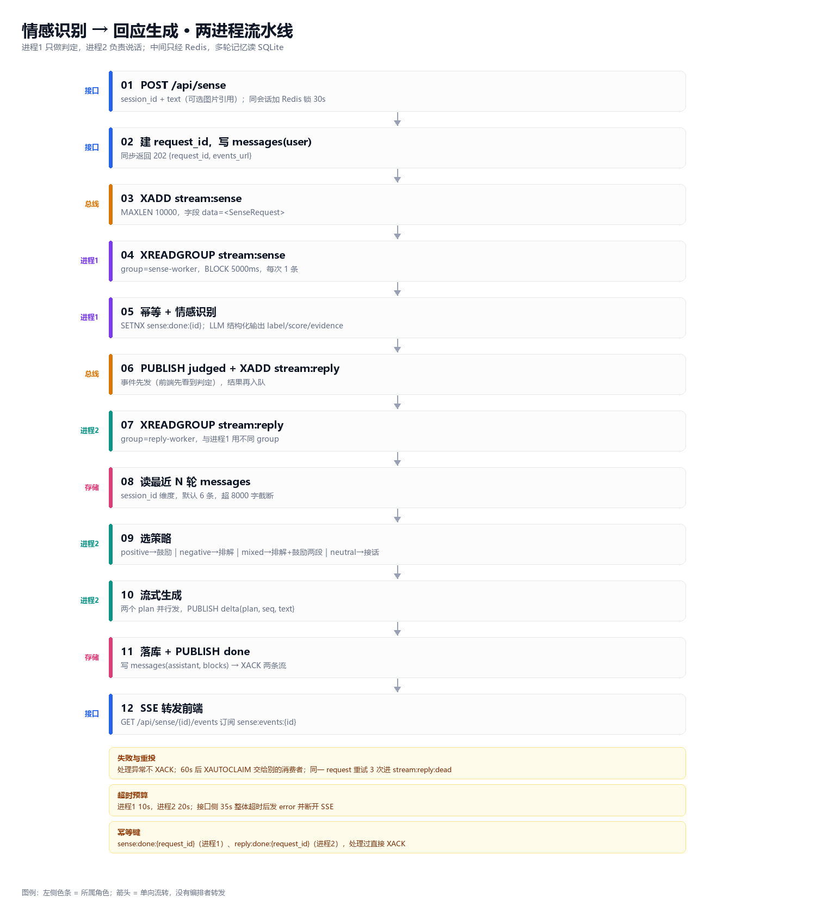
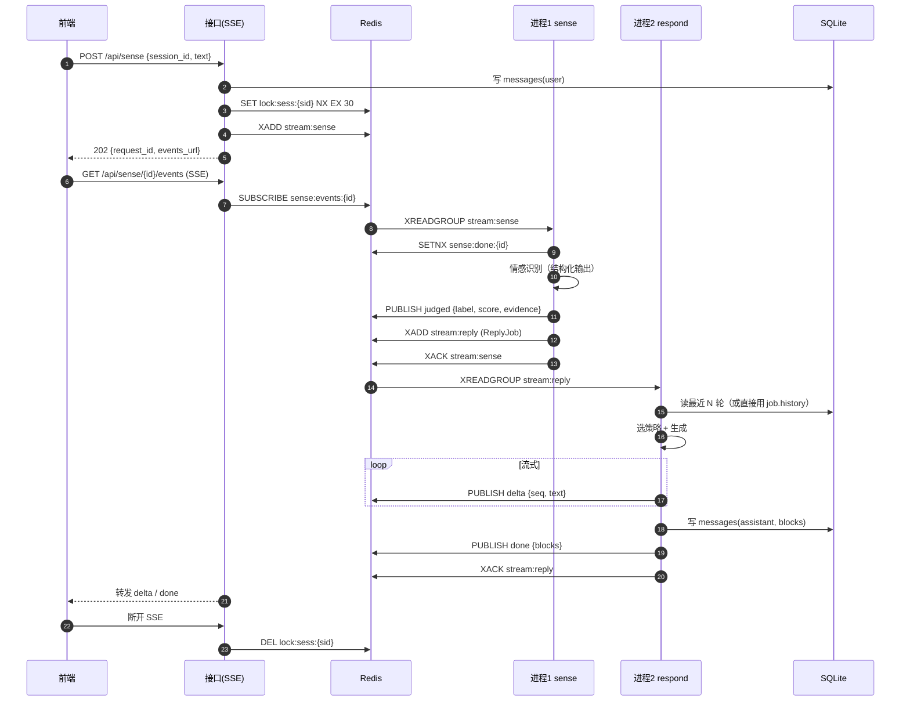

# 情感识别 → 回应生成 · 两进程流水线设计

一句话：**进程1 只负责「判定」，进程2 只负责「说话」**，中间只经 Redis，多轮记忆读 SQLite。



---

## 1. 为什么是两段流水线而不是多 agent 网络

这个需求是**串行、单向、无并行、无人审**的三无流程：A 产出 B 的输入，B 产出最终回答。
没有「谁调用谁」的协商，也没有多个专家同时给意见。

所以：

- **不要 orchestrator**。加一个编排进程，它做的唯一一件事是「把 A 的结果转发给 B」——
  多了一个会挂、会积压、会脑裂的进程，收益为零。
- **不要 Kafka**。消息就在几秒内被消费，没有「几小时前重放」的需求；Redis Stream
  自带 consumer group、ack、pending 认领，够用且少一层运维。
- **不要 HTTP 互调**。A 直接 POST 给 B，B 一挂消息就丢，还得自己做重试缓冲——那是
  把队列手写一遍。

将来要跨机器、要多实例、要审计三个月，把 `XADD` 换成 Kafka `send` 就行，代码里一处。

## 2. 组件与职责

| 组件 | 进程/位置 | 职责 | 有状态 |
| :--- | :--- | :--- | :--- |
| `api` | 可与进程1 同进程 | 收请求、建 `request_id`、落用户消息、`XADD`、SSE 转发 | 无 |
| `sense` | 进程 1 | 消费 `stream:sense` → 幂等 → 情感识别 → `PUBLISH` 判定 → `XADD stream:reply` | 无（可多副本） |
| `respond` | 进程 2 | 消费 `stream:reply` → 读历史 → 选策略 → 流式生成 → 落库 → `PUBLISH done` | 只读历史 |
| Redis | 中间件 | 两条 Stream + 一个 Pub/Sub 频道 + 锁 + 幂等键 + DLQ | — |
| SQLite | 存储 | `conversations` / `messages`，多轮记忆的唯一来源 | — |

进程 1 不直接回答用户：它只产出「判定 + 证据」。这个分法的好处是**判定可以换模型、
换供应商，不影响话术；话术可以调风格，不影响判定。**

## 3. 消息结构

放在 `src/chatbi/sense/contracts.py`，全部继承项目里的 `Contract`
（`ConfigDict(extra="forbid", frozen=True)`），字段改动必须过类型检查。

### 3.1 入队：`SenseRequest`

```python
class SenseRequest(Contract):
    schema_version: int = 1
    request_id: UUID              # 一次提问的唯一标识，贯穿全链路
    session_id: str               # 会话；决定多轮记忆的范围
    text: str = ""                # 用户原话
    image_ref: str | None = None  # 大对象走引用（文件路径/对象键），不塞消息
    created_at: datetime
```

### 3.2 进程1 产出：`SenseResult`

```python
class Emotion(StrEnum):
    POSITIVE = "positive"
    NEGATIVE = "negative"
    NEUTRAL = "neutral"
    MIXED = "mixed"        # 又夸又怨、反讽、嘴上说没事

class SenseResult(Contract):
    schema_version: int = 1
    request_id: UUID
    label: Emotion
    score: float = Field(ge=0, le=1)     # 对该标签的置信度
    evidence: list[str] = Field(max_length=3)   # 判定依据的原文片段
    segments: list[Segment] = Field(max_length=2)  # 只有 MIXED 有内容，最多两段
    model: str
    elapsed_ms: int
    created_at: datetime


class Segment(Contract):
    """一句话里的一段情绪。用原文子串而不是 offset：中文偏移经常差一两个字。"""

    text: str                        # 原文片段，服务端用 text.find 定位
    polarity: Literal["positive", "negative"]
    weight: float = Field(ge=0, le=1)  # 这段在本句里的分量
```

`evidence` 不能省：用户问「你凭什么说我难过」时，这是唯一能拿出来的东西。
`MIXED` 必须单独存在——「我没事」「挺好的吧」这种反讽如果被分到 `POSITIVE`
直接去鼓励，会显得很蠢。

**`segments` 只有 `MIXED` 才有内容**，其余三种标签留空数组。**最多两段，由 LLM 判断要不要拆**：
切出五段的话，回应会变成「针对第一点……针对第二点……」，像客服工单。

### 3.3 入队：`ReplyJob`（进程2 的输入）

```python
class ReplyMode(StrEnum):
    ENCOURAGE = "encourage"    # 鼓励
    CONSOLE = "console"        # 排解
    NEUTRAL = "neutral"        # 不做情绪加工，正常接话

class ReplyPlan(Contract):
    """一段回应计划：用什么语气，回应哪几个原文片段。"""

    mode: ReplyMode
    targets: list[str] = Field(max_length=2)   # 原文片段（从 sense.segments 来）
    order: int                                  # 拼接顺序，从 0 开始

class ReplyJob(Contract):
    schema_version: int = 1
    request_id: UUID
    session_id: str
    plans: list[ReplyPlan] = Field(max_length=2)  # 按 order 执行
    sense: SenseResult
    history: list[ChatTurn] = []        # 最近 N 轮，见 §5
    deadline_ms: int                    # 绝对时间戳（epoch ms），沿链路递减
    attempt: int = 0
    created_at: datetime
```

`MIXED` 会拆成两个 plan：`console`（负面段，order=0）→ `encourage`（正面段，order=1）。
其余标签只有一个 plan。**排序固定为「先接住、再给力气」**——情绪先落地，最后留一句向前的，
读起来是被理解之后被托住；反过来先夸再安慰，会像先敷衍再补救。

`history` 在入队时就带上，而不是让进程2 再去查一次：**同一条消息自带全部输入**，
进程2 因此可以完全无状态地重放（重投同一条消息结果一致）。

### 3.4 最终产出：`ReplyResult`

```python
class ReplyResult(Contract):
    schema_version: int = 1
    request_id: UUID
    session_id: str
    text: str
    blocks: list[dict] = []   # 复用 answer_blocks：{"type": "text" | "image", ...}
    model: str
    elapsed_ms: int
    created_at: datetime
```

### 3.5 失败：`PipelineError`

```python
class PipelineError(Contract):
    schema_version: int = 1
    request_id: UUID
    stage: Literal["sense", "reply"]
    code: Literal["timeout", "model_call", "model_output", "internal"]
    message: str          # 给用户看的短句，不含堆栈
    attempt: int
    created_at: datetime
```

## 4. 通信协议

### 4.1 Redis 键与流

| 键 | 类型 | 用途 | 关键参数 |
| :--- | :--- | :--- | :--- |
| `stream:sense` | Stream | 待识别的请求 | `MAXLEN ~ 10000` |
| `stream:reply` | Stream | 待生成的回应任务 | `MAXLEN ~ 10000` |
| `sense-workers` | Group | 进程1 消费组 | 单条 `XREADGROUP BLOCK 5000 COUNT 1` |
| `reply-workers` | Group | 进程2 消费组 | 同上 |
| `sense:done:{request_id}` | String | 进程1 幂等键 | `SET NX EX 3600` |
| `reply:done:{request_id}` | String | 进程2 幂等键 | `SET NX EX 3600` |
| `lock:sess:{session_id}` | String | 同会话串行 | `SET NX EX 30`，用完 `DEL` |
| `sense:events:{request_id}` | Pub/Sub 频道 | SSE 事件源 | 无持久化，订阅者不在就丢 |
| `stream:dead` | Stream | 重试耗尽的死信 | 保留人工处理，**不自动重投** |
| `hb:sense:{pid}` / `hb:reply:{pid}` | String | 心跳 | `SET EX 15` |

**流字段**统一只有一个：`data`，值是模型的 JSON（`model_dump_json()`）。
不用 `XADD * key1 v1 key2 v2` 的散字段——多一个字段就多一处和模型不同步的地方。

### 4.2 投递与消费

```
生产：XADD stream:sense MAXLEN ~ 10000 * data '<SenseRequest JSON>'
消费：XGROUP CREATE stream:sense sense-workers $ MKSTREAM      （首次）
      XREADGROUP GROUP sense-workers {consumer} COUNT 1 BLOCK 5000 STREAMS stream:sense >
成功：XACK stream:sense sense-workers {entry_id}
失败：不 XACK，交给 pending 认领
救援：XAUTOCLAIM stream:sense sense-workers {consumer} 60000 0 COUNT 10
```

三条纪律：

1. **处理完才 `XACK`**。提前 ack 等于「取到就算做完」，进程一崩任务就没了。
2. **`XAUTOCLAIM` 的 min-idle 必须大于单条最长处理时间**（60s > 10s/20s 预算），
   否则会把正在跑的活抢走，同一请求被处理两次。
3. 消费者名用 `{hostname}-{pid}`，进程重启后旧 pending 才会被识别为「孤儿」。

### 4.3 时序



### 4.4 SSE 事件（接口 → 前端）

统一帧格式 `event: <name>\ndata: <json>\n\n`，每 15 秒一行注释 `: ping` 保活。

| 事件 | data | 说明 |
| :--- | :--- | :--- |
| `accepted` | `{request_id, session_id}` | 已入队，前端可以开等了 |
| `judged` | `{label, score, evidence}` | 判定出来了，前端可以先显示一个情绪标签 |
| `delta` | `{plan, seq, text}` | 正文增量；`plan` 是 0/1（对应 `plans` 下标），前端按 `plan` 分组、组内按 `seq` 追加 |
| `done` | `{text, blocks}` | 结束；`blocks` 与历史里的形状一致 |
| `error` | `{code, message}` | 失败；前端显示 `message`，不要再重试同一请求 |
| `: ping` | — | 保活注释，不算事件 |

`judged` 先于 `delta`：让用户先看到「我知道你不开心」，再看到一大段话，体感差很多。

### 4.5 超时、重试、幂等

| 项目 | 值 | 说明 |
| :--- | :--- | :--- |
| 进程1 单条预算 | 10s | 情感识别一次模型调用 |
| 进程2 单条预算 | 20s | 含流式生成 |
| 接口整体超时 | 35s | 超过就发 `error` 并断开 SSE |
| 最大重试 | 3 次 | `attempt` 存在消息里，递增 |
| 重试退避 | 1s / 4s / 9s | 写入 `Pending` 的下次可见时间由消费者自己 sleep |
| 死信 | `stream:dead` | 不自动重投，人工看 |
| 会话锁 TTL | 30s | 进程崩了锁自动过期，不会永久卡住 |

**幂等**：`SET NX` 成功才干活；已存在说明处理过，直接 `XACK` 跳过。这样即使
`XAUTOCLAIM` 把同一条消息交到另一个副本手上，也不会重复调用模型。

**顺序**：情感识别本身无状态，可并行；但**同一会话的回应必须串行**，否则两条回复会
互相踩上下文、语气也接不上。所以入队前抢 `lock:sess:{session_id}`，抢不到直接返回
`error{code:"busy"}` 让前端排队——比在后端无限等更诚实。

### 4.6 MIXED：一句话拆两段，两次调用并行发

`label == mixed` 时，进程1 已经把原话切成最多两段（一段正、一段负）。进程2 据此排两个 plan：

| plan | mode | targets | 交给哪套提示词 |
| :--- | :--- | :--- | :--- |
| 0 | `console` | 负面段的原文 | `CONSOLE_PROMPT` |
| 1 | `encourage` | 正面段的原文 | `ENCOURAGE_PROMPT` |

**为什么是两次调用，而不是一次调用里写「既安慰又鼓励」**：鼓励的结构是「具体 → 判断」，
排解得是「承认 → 命名 → 一个小动作」。混在一个提示词里，模型必然会写成
「我理解你，但你要相信自己」——最油的那种。

**并行发，不是串行**：两个 plan 在进程2 里 `asyncio.gather` 同时开跑，
首 token 大概 2–3 秒，不会因为拆两段而翻倍。代价是事件要按 `plan` 分组：

```
event: delta  data: {"plan": 0, "seq": 1, "text": "被当众说那句，确实难受。"}
event: delta  data: {"plan": 0, "seq": 2, "text": "不是你的能力强弱问题。"}
event: delta  data: {"plan": 1, "seq": 1, "text": "不过你把方案重做了一遍，这件事做对了。"}
```

前端按 `plan` 分组、组内按 `seq` 追加，**组间按 plan 的 order 顺序渲染**。
如果 plan=1 先到，先缓着——一上来先夸会显得没接住。

**过渡句**：`plan 0` 结尾由提示词自然收束，`plan 1` 开头用「不过 / 另外」这类转折起，
不用代码硬拼连接词——硬拼的词放在不合适的句子后面会很假。

**降级**：`segments` 为空、或者 `text.find()` 定位失败时，退回单一 plan：

| 条件 | 降级 |
| :--- | :--- |
| 只找到负面段 | 单 plan `console` |
| 只找到正面段 | 单 plan `encourage` |
| 两段都定位不到 | 按 `label` 走整体策略，`mixed` 当 `negative` 处理（宁可接住，不要错夸） |

## 5. 多轮记忆

### 5.1 表结构

库文件 `data/sense/sense.db`（与 mmrag 的 `rag.db` 分开，避免互相锁）。

```sql
CREATE TABLE IF NOT EXISTS conversations (
    session_id  TEXT PRIMARY KEY,
    title       TEXT NOT NULL DEFAULT '',      -- 首条用户消息前 30 字
    turns       INTEGER NOT NULL DEFAULT 0,
    created_at  TEXT NOT NULL,
    updated_at  TEXT NOT NULL
);

CREATE TABLE IF NOT EXISTS messages (
    id          TEXT PRIMARY KEY,              -- uuid
    session_id  TEXT NOT NULL,
    role        TEXT NOT NULL,                 -- user | assistant
    text        TEXT NOT NULL DEFAULT '',
    blocks      TEXT,                          -- JSON，assistant 用
    sense_label TEXT,                          -- 仅 user 行：本次判定
    created_at  TEXT NOT NULL
);
CREATE INDEX IF NOT EXISTS idx_messages_session ON messages(session_id, created_at);
```

### 5.2 取数与预算

- 取**最近 6 条**（3 轮），按 `created_at DESC` 取完再翻回正序；
- 单条正文截断 8000 字，合计不超过 24000 字，超了从最老的开始丢；
- 只带 `role` 与 `text`，不带 `blocks`（图片不进上下文，避免 token 爆炸）；
- 上一轮的 `sense_label` 一起带上——**「他上一条是负面，这条突然说没事」本身就是信号**，
  让进程2 的模型看见这个跳变。

### 5.3 写入时机

| 时机 | 写什么 |
| :--- | :--- |
| 接口收到请求 | `messages(user)` + `conversations.turns+1` |
| 进程2 生成完 | `messages(assistant, blocks)` + `conversations.updated_at` |
| 任何环节失败 | 只写 user 行；assistant 缺省留空，前端显示错误，不影响下一轮取数 |

**为什么不把 `history` 只放数据库**：`ReplyJob` 里带一份快照，进程2 可以完全不查库就跑
（方便单测、方便重放）；数据库那份只用于「历史列表」这种用户可见的读。

## 6. HTTP 接口

### `POST /api/sense`

```json
{ "session_id": "s-01H...", "text": "今天被领导当众说了，烦死" }
```

- `200/202` → `{ "request_id": "...", "events_url": "/api/sense/{id}/events" }`
- `409` → 会话忙（`error.code = "busy"`）
- `422` → `text` 为空且没有图片

### `GET /api/sense/{request_id}/events`

`text/event-stream`，见 §4.4。订阅 `sense:events:{request_id}`；连接建立时先补发一条
当前状态（如果判定已出，直接给 `judged`），避免「刚好错过第一条事件」。

### `GET /api/sense/sessions` / `GET /api/sense/sessions/{id}/messages`

与 mmrag 的会话接口同形，前端可以复用同一个历史栏组件。

## 7. 失败矩阵

| 现象 | 表现 | 处理 |
| :--- | :--- | :--- |
| 进程1 模型超时 | 无 `judged` | 重试 3 次；仍失败发 `error{code:"timeout"}`，用户消息保留 |
| 进程1 输出不合模型 | `MODEL_OUTPUT` | **不重试**（同样的输入还会错），直接 `error` |
| 进程1 崩在识别中途 | 消息停在 pending | 60s 后 `XAUTOCLAIM` 接管 |
| 进程2 崩在生成中途 | 前端只收到半截 `delta` | 重投后重跑；前端按 `seq` 覆盖，不会拼出两段 |
| 进程2 写库失败 | 有 `done` 没落库 | 先写库再 `PUBLISH done`，顺序不能反 |
| 接口与 Redis 断开 | SSE 无心跳 | 前端 30s 无 `ping` 主动重连，服务端补发当前状态 |
| 会话锁未释放 | 后续请求 409 | TTL 30s 自动过期；正常路径在 `done` 后 `DEL` |
| 消息积压 | `XLEN` 持续上涨 | `XLEN > 1000` 告警——说明进程2 卡住或没起来 |

## 8. 部署

```bash
# 进程1（可带 --workers 2，Redis 组内自然分流）
python -m chatbi.sense

# 进程2
python -m chatbi.respond

# 接口（也可以并进进程1）
uvicorn chatbi.sense.api:create_app --factory --host 127.0.0.1 --port 8800
```

Windows 上用 nssm 托管，崩溃自动拉起；GPU 实例那套继续用 `nohup` + `run-worker.sh`。
两个进程只依赖 Redis 与 SQLite，**没有别的中间件**。

启动自检（缺一个就别起）：

```
PING redis            → PONG
XINFO GROUPS stream:sense   → sense-workers 存在（不存在就 CREATE MKSTREAM）
PRAGMA integrity_check on sense.db → ok
```

## 9. 观测

每个进程一份 JSONL 台账（照 `src/chatbi/mmrag/worker/audit.py` 的写法，`OSError` 只 warning）：

```json
{"ts":"2026-11-19T12:31:02+08:00","stage":"sense","request_id":"...","session_id":"...",
 "label":"negative","score":0.82,"elapsed_ms":1840,"attempt":0,"ok":true}
```

三个必须能一眼查到的量：**单条耗时、失败率、队列深度**。前两个看台账，第三个 `XLEN`。

## 10. 参数默认值

| 参数 | 默认 | 说明 |
| :--- | :--- | :--- |
| `SENSE_TIMEOUT_S` | 10 | 进程1 单条预算 |
| `REPLY_TIMEOUT_S` | 20 | 进程2 单条预算 |
| `SENSE_HISTORY_TURNS` | 3 | 带几轮上下文 |
| `SENSE_HISTORY_CHARS` | 24000 | 上下文总字数上限 |
| `SENSE_MAX_ATTEMPTS` | 3 | 超过进死信 |
| `SENSE_CLAIM_IDLE_MS` | 60000 | `XAUTOCLAIM` 最小空闲 |
| `SENSE_STREAM_MAXLEN` | 10000 | 两条流的保留长度 |
| `SENSE_LOCK_TTL_S` | 30 | 会话锁 |

## 11. 提示词（两套，分开写）

放在 `src/chatbi/sense/prompts.py`，两套共用同一段「不要做什么」，但**结构不同**：

- 鼓励是「具体 → 判断」；
- 排解是「承认 → 命名 → 一个小动作」。

混在一个提示词里，模型一定会写成「我理解你，但你要相信自己」——最油的那种。

### 11.1 `ENCOURAGE_PROMPT`

```
你是站在对方身边的人，不是教练，不是啦啦队。

规则：
1. 先接住他说的那件具体的事，一句话，复述他做对的部分，可以引用他的原话片段。
2. 再给一句向前的判断，说清"为什么这算好"，不要泛泛而谈。
3. 最多 4 句，80 字以内。不用感叹号，不排比。

禁止：你真棒 / 相信自己 / 加油哦 / 未来可期。
禁止：复述整段原文。
禁止：给三条以上建议。
```

### 11.2 `CONSOLE_PROMPT`

```
你是坐在旁边的人，不是心理咨询师，不是来解决问题的。

规则：
1. 先承认这件事确实难，不要评价对错，不要说"其实还好"。
2. 用一句话把他的情绪说准（"你不是气他骂你，是气他当着人"），说不准就只说"这确实难受"。
3. 只给一个当下能做的小动作（喝口水 / 出去走五分钟 / 把话先写完不发出），不给计划。
4. 最多 4 句，90 字以内。不追问。

禁止：想开点 / 这没什么 / 别难过 / 你太敏感了。
禁止：拿别人的处境比较。
禁止：连续三条建议。
```

### 11.3 判定用的 `SENSE_PROMPT`（要点）

判定不是分类器，要把「凭什么」一起产出来：

1. 输出 `label` / `score` / `evidence`（最多 3 条原文片段）/ `segments`（最多 2 段）。
2. **反讽、口是心非、自我贬低、拿反话安慰自己，一律算 `negative`**。
   「被领导夸了，挺好的吧」→ negative，不能给鼓励。
3. 只有在**同一句话里同时出现独立的正负事件**时才判 `mixed`，并给出两段。
   「被骂了但方案最后过了」→ mixed；「被骂了但我不在乎」→ negative（不是 mixed）。
4. `segments.text` 必须是原文的**连续子串**，不能改写、不能补标点。
5. 拿不准时判 `neutral`，并给 `score` 偏低——宁可不动情绪，也不要错夸。

## 12. 还没定的

1. **`MIXED` 的判定边界**：上面第 3 条是现在的规则，需要拿真实样本校准，
   否则会过度触发。建议先跑 50 条真人语料，人工标一遍再调。
2. **语气要像谁**：现在两版提示词是「平、短、不油」的基调；如果要更暖或更克制，
   改的是提示词里的措辞密度，不是加形容词。
3. **要不要做流式打断**：用户在主回复生成中又发一句，现在是 409 busy；
   更好的做法是打断当前 plan 重新判定，但要先解决"已经输出的半句怎么处理"。

## 13. 两个 runtime：谁负责哪一段

同一套契约（`contracts.py`）、同一套提示词（`prompts.py`）、同一套拆段排序
（`planning.py`）、同一套记忆（`history.py`），只有「谁在跑循环」不一样：

| | `SENSE_RUNTIME=agents` | `SENSE_RUNTIME=graph` |
| --- | --- | --- |
| 底层库 | OpenAI Agents SDK | LangGraph |
| runtime 归谁 | **我们负责一部分**：自己解析模型输出、自己拼 prompt、自己收流 | **用它自己的**：图、状态、checkpoint、流式自定义通道 |
| 结构化输出 | 让模型吐 JSON，`parse_verdict()` 抠出来校验 | `with_structured_output(..., method="json_mode")` |
| 流式 | `Runner.run_streamed()` + `ResponseTextDeltaEvent` | 节点里 `get_stream_writer()`，外层 `stream_mode=["custom","values"]` |
| 断点续跑 | 没有 | `AsyncSqliteSaver` + `thread_id=reply:{request_id}` |
| 判定 | 固定走 agents（只吐一段 JSON，用不上图） | 走 graph |
| 实测（同一句） | 20.2s / 65 个增量 | 26.3s / 58 个增量 |

选型建议：**线上走 agents**（少一层抽象、延迟低、出错栈短）；**要断点续跑、
要人审中断、要回放某次生成**才切 graph——这些正是 LangGraph 自己的 runtime 值
钱的地方。切换只改 `.env` 里一行，不用动业务代码。

### 两个 provider 兼容坑（DeepSeek）

1. **不支持 `response_format=json_schema`**：调了直接回
   `400 This response_format type is unavailable now`。所以不用 SDK 的
   `output_type`，改成让模型吐 JSON 文本 + 我们 `parse_verdict()` 解析。
2. **`json_object` 模式要求提示词里出现 "json" 字样**：否则
   `400 Prompt must contain the word 'json' in some form`。`SENSE_PROMPT` 末尾
   显式写了「只输出一个 json 对象」并附两个示例，两个 runtime 共用这段。
3. 附带一条：`AsyncSqliteSaver` 不会创建父目录，`data/sense/` 必须先建好。

### 怎么对比

```bash
python -m chatbi.sense.compare "项目上线了很开心，但爷爷刚走"
python -m chatbi.sense.compare "今天有点累" --runtime graph
```

打印判定、分数、plan 顺序、分段、证据、两段回应、耗时、增量数；一条报错不影响
另一条，方便直接看差异。
